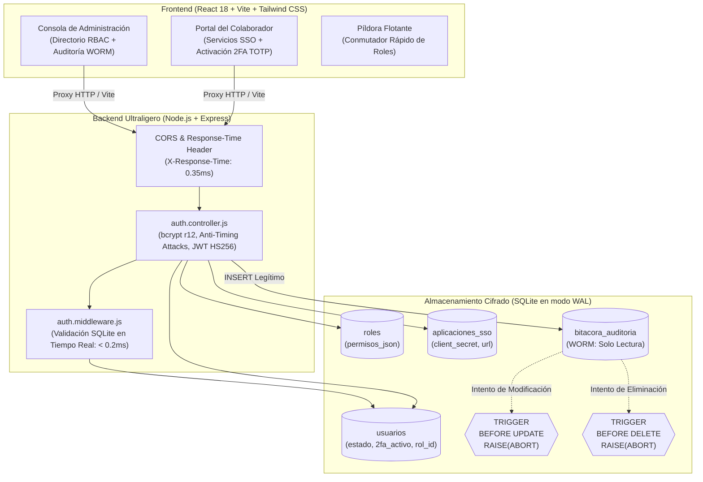

# 🛡️ IAM PyME — Gestor de Identidad y Accesos Ligero para PyMEs

[](https://nodejs.org/)
[](https://expressjs.com/)
[](https://www.sqlite.org/)
[](https://react.dev/)
[](https://tailwindcss.com/)
[](https://vitejs.dev/)
[](https://en.wikipedia.org/wiki/Write_once_read_many)

Solución integral de **Gestión de Identidad y Accesos (IAM)**, **Autenticación Federada (SSO)** y **Bitácora Inmutable (WORM)** diseñada para pequeñas y medianas empresas. Resuelve la dispersión de credenciales, facilita la revocación inmediata de accesos (*Offboarding Express*) y garantiza el principio de no repudio sin costos de infraestructura pesada.

---

## 🏛️ Arquitectura del Sistema



---

## 🔒 Principios de Ciberseguridad Implementados

1. **Latencia Sub-segundo Garantizada (< 1 ms en lecturas):**
   - SQLite configurado en modo **WAL (*Write-Ahead Logging*)** mediante `PRAGMA journal_mode = WAL`. Permite lecturas y escrituras simultáneas sin bloqueos de tabla.
   - Encabezado HTTP `X-Response-Time` inyectado en cada respuesta para monitoreo de rendimiento.
2. **Auditoría Estrictamente Inmutable (WORM - *Write Once, Read Many*):**
   - Disparadores nativos de base de datos (`BEFORE UPDATE` y `BEFORE DELETE`) en la tabla `bitacora_auditoria` con `SELECT RAISE(ABORT, ...)` que abortan de raíz cualquier intento de manipular o borrar registros forenses.
3. **Hashing de Alta Resistencia:**
   - Contraseñas protegidas con `bcrypt` y factor de costo (**12 Salt Rounds**), ofreciendo una barrera exponencial contra ataques por diccionario asistidos por GPU/ASIC.
4. **Mitigación de Timing Attacks (Canal Lateral):**
   - Si un usuario no existe, el endpoint de login ejecuta `bcrypt.compare` contra un *Dummy Hash* precalculado, unificando los tiempos de respuesta y previniendo la enumeración de correos.
5. **Offboarding Express con Revocación Instantánea:**
   - Cambio de estado a `'inactivo'` en un clic.
   - El middleware verifica el estado activo en SQLite en cada petición HTTP (`< 0.2ms`), invalidando cualquier token JWT huérfano de inmediato.
6. **Autenticación en Dos Factores (RFC 6238 TOTP):**
   - Generación de secretos Base32 de 160 bits con Speakeasy, compatibles con Google Authenticator, Microsoft Authenticator y Authy.
7. **Protección de Cabeceras HTTP con Helmet.js:**
   - Mitigación de Clickjacking (`X-Frame-Options: SAMEORIGIN`), protección contra MIME-sniffing (`nosniff`), HSTS y eliminación de huella tecnológica.
8. **Protección contra Fuerza Bruta con Rate Limiting:**
   - Control de intentos en `/api/v1/auth/login` con `express-rate-limit` (máximo 5 intentos por IP en 15 minutos con respuesta HTTP 429).
9. **Sanitización Estricta de Entradas (Anti-XSS e Inyecciones):**
   - Validación de formato RFC de correo electrónico y escape automático de entidades HTML en nombres de usuario mediante `validator`.
10. **Manejo Global de Errores Inteligente:**
    - Supresión total de stack traces de base de datos en modo producción para prevenir fuga de información sensible.

---

## 📁 Estructura del Proyecto

```text
proyecto-iam-pyme/
├── package.json              # Configuración principal y scripts de ejecución
├── .env                      # Variables de entorno (puertos, secretos JWT)
├── .env.example              # Plantilla pública de variables
├── .gitignore                # Exclusión de node_modules y archivos SQLite
├── database.js               # Conexión SQLite, esquemas, índices y triggers WORM
├── server.js                 # Servidor Express ultraligero con CORS y health checks
├── auth.controller.js        # Lógica de registro, login, 2FA, offboarding y consultas
├── auth.routes.js            # Definición modular de rutas de la API REST
├── auth.middleware.js        # Verificación de JWT y chequeo de estado activo en vivo
├── seed.js                   # Semillero de datos de prueba para demostraciones
├── test-audit.js             # Test automatizado de inmutabilidad de triggers
├── test-auth.js              # Test automatizado de ciberseguridad (bcrypt, JWT, offboarding)
├── test-e2e-qa.js            # Test integral de QA de punta a punta (CORS, 2FA, APIs)
├── MANUAL_DE_USO.md          # Manual de usuario formal para rúbrica de titulación
│
└── frontend-iam/             # Aplicación Cliente (Single Page Application)
    ├── package.json          # Dependencias (React 18, Lucide, Tailwind CSS)
    ├── vite.config.js        # Configuración de Vite con reglas de proxy inverso
    ├── tailwind.config.js    # Paleta de diseño corporativo (azul y naranja)
    ├── index.html            # Plantilla HTML con tipografía geométrica Inter
    └── src/
        ├── App.jsx           # Enrutador principal y conmutador rápido de roles
        ├── index.css         # Directivas de Tailwind CSS
        ├── main.jsx          # Punto de entrada de React 18
        └── components/
            ├── DashboardAdmin.jsx   # Consola de Administración y métricas KPI
            ├── TablaUsuarios.jsx    # Directorio RBAC con botón Offboarding Express
            ├── AuditoriaView.jsx    # Visualizador de solo lectura de la bitácora WORM
            └── PortalEmpleado.jsx   # Portal SSO con tarjetas y configuración 2FA
```

---

## 🚀 Guía de Inicio Rápido

### Requisitos Previos
* **Node.js** v18 o superior (probado y certificado en Node.js v24).
* **npm** v9 o superior.

### Paso 1: Clonar o ingresar al proyecto
```bash
cd d:\Escritorio\proyecto-iam-pyme
```

### Paso 2: Instalar dependencias (Backend y Frontend)
```bash
# Instalar dependencias del backend
npm install

# Instalar dependencias del frontend
npm --prefix frontend-iam install
```

### Paso 3: Sembrar la Base de Datos con Cuentas de Prueba
```bash
npm run seed
```

### Paso 4: Levantar los Servidores
Recomendamos abrir **dos consolas de terminal**:

* **Terminal 1 — Servidor Backend (API Express + SQLite):**
  ```bash
  npm run dev
  ```
  *Servidor escuchando en:* `http://localhost:3000`  
  *Health Check:* `http://localhost:3000/health`

* **Terminal 2 — Interfaz de Usuario (React + Vite):**
  ```bash
  npm run frontend
  ```
  *Aplicación web disponible en:* `http://localhost:5173/`

---

## 🔑 Cuentas de Prueba Preconfiguradas

| Perfil | Correo Electrónico | Contraseña | Rol / Privilegios | Estado Inicial |
| :--- | :--- | :--- | :---: | :---: |
| **Administrador TI** | `admin@pyme.com` | `MiContraseñaSegura2026!` | `Administrador` (`*`) | Activo (2FA Habilitado) |
| **Empleado Operaciones** | `carlos.mendoza@pyme.com` | `MiContraseñaSegura2026!` | `Empleado` | Activo (2FA Pendiente) |
| **Administradora General** | `ana.gomez@pyme.com` | `MiContraseñaSegura2026!` | `Administrador` (`*`) | Activo (2FA Habilitado) |
| **Empleada Nómina** | `lucia.fernandez@pyme.com` | `MiContraseñaSegura2026!` | `Empleado` | Activo (2FA Pendiente) |
| **Empleado Desvinculado** | `jorge.ramirez@pyme.com` | `MiContraseñaSegura2026!` | `Empleado` | Inactivo (Offboarded) |

---

## 🧪 Batería de Pruebas Automatizadas

El proyecto incluye 3 suites de pruebas automatizadas listas para su ejecución:

```bash
# 1. Verificar inmutabilidad de la bitácora (Triggers SQLite WORM)
npm run test:audit

# 2. Verificar ciberseguridad, hashing bcrypt, JWT y mitigación de timing attacks
npm run test:auth

# 3. Certificación integral de QA de punta a punta (APIs, CORS, 2FA, Offboarding)
npm run test:qa

# 4. Verificación de hardening avanzado (Helmet, Rate Limiter 429, XSS, Zero Leak)
npm run test:hardening
```

---

## 📖 Documentación y Rúbrica Académica

Para consultar el manual técnico formal detallado para la rúbrica docente, consulte el archivo:
📄 **[MANUAL_DE_USO.md](file:///d:/Escritorio/proyecto-iam-pyme/MANUAL_DE_USO.md)**
